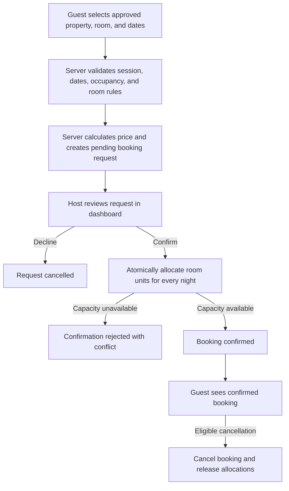

# Architecture Document

## Next.js & MongoDB Homestay Application (Dharamshala)

**Version:** 1.0 (MVP)
**Date:** 2026-04-11

---

## 1. High-Level Architecture

```
┌─────────────────────────────────────────────────────────────┐
│                      Browser (Client)                       │
│   React Components (Tailwind)  ──►  Next.js App Router      │
└──────────────┬──────────────────────────────┬───────────────┘
               │  Server Components / SSR      │  Client fetch
               ▼                              ▼
┌─────────────────────────────────────────────────────────────┐
│                  Next.js Server (Route Handlers)            │
│   /api/properties  (GET, POST)  ──►  Mongoose Models        │
└──────────────┬──────────────────────────────────────────────┘
               ▼
┌─────────────────────────────────────────────────────────────┐
│              MongoDB (local: localhost:27017/homestay_db)   │
│   Collections: users, properties, rooms                     │
└─────────────────────────────────────────────────────────────┘
```

- **Frontend/Backend in one repo** via Next.js App Router (server + client components).
- **Data layer:** Mongoose ODM over local MongoDB.
- **Styling:** Tailwind CSS utility classes.

---

## 2. Folder Structure

```
homestay-app/
├── app/
│   ├── layout.tsx                    # Root layout (fonts, providers)
│   ├── page.tsx                      # Landing / home
│   ├── globals.css                   # Tailwind directives
│   ├── (guest)/
│   │   ├── properties/
│   │   │   ├── page.tsx              # Search & listing page
│   │   │   └── [id]/
│   │   │       └── page.tsx          # Property detail view
│   │   └── layout.tsx
│   ├── host/
│   │   ├── dashboard/
│   │   │   └── page.tsx             # Host dashboard
│   │   └── new-property/
│   │       └── page.tsx             # Create listing page
│   └── api/
│       └── properties/
│           └── route.ts             # GET + POST handlers
├── components/
│   ├── ui/                          # Reusable primitives
│   │   ├── Button.tsx
│   │   ├── Input.tsx
│   │   ├── Card.tsx
│   │   └── Badge.tsx
│   ├── host/
│   │   └── PropertyForm.tsx         # Multi-step host form
│   ├── listing/
│   │   ├── PropertyCard.tsx
│   │   ├── SearchFilters.tsx
│   │   └── RoomTable.tsx
│   └── layout/
│       ├── Navbar.tsx
│       └── Footer.tsx
├── lib/
│   ├── dbConnect.ts                 # Mongoose connection utility
│   └── utils.ts                     # Helpers (cn, formatPrice, ...)
├── models/
│   ├── User.ts
│   ├── Property.ts
│   └── Room.ts
├── types/
│   └── index.ts                     # Shared TS interfaces
├── public/
│   └── images/
├── .env.local                       # MONGODB_URI, etc.
├── next.config.mjs
├── tailwind.config.ts
├── tsconfig.json
└── package.json
```

---

## 3. Database Connection (`lib/dbConnect.ts`)

```ts
// lib/dbConnect.ts
import mongoose from 'mongoose';

const MONGODB_URI = process.env.MONGODB_URI || 'mongodb://localhost:27017/homestay_db';

interface MongooseCache {
  conn: typeof mongoose | null;
  promise: Promise<typeof mongoose> | null;
}

declare global {
  // eslint-disable-next-line no-var
  var mongooseCache: MongooseCache | undefined;
}

const cached: MongooseCache = global.mongooseCache || { conn: null, promise: null };
if (!global.mongooseCache) global.mongooseCache = cached;

export async function dbConnect(): Promise<typeof mongoose> {
  if (cached.conn) return cached.conn;

  if (!cached.promise) {
    cached.promise = mongoose.connect(MONGODB_URI, {
      bufferCommands: false,
    }).then((m) => m);
  }

  try {
    cached.conn = await cached.promise;
  } catch (err) {
    cached.promise = null;
    throw err;
  }

  return cached.conn;
}

export default dbConnect;
```

**Notes:**
- Caches the connection on `global` to survive Next.js HMR / serverless invocations.
- Falls back to `mongodb://localhost:27017/homestay_db` if env var is missing.
- `bufferCommands: false` surfaces connection errors early.

---

## 4. Mongoose Schemas

### 4.1 `models/User.ts`

```ts
// models/User.ts
import mongoose, { Schema, Document, Model } from 'mongoose';

export type UserRole = 'guest' | 'host';

export interface IUser extends Document {
  name: string;
  email: string;
  passwordHash: string;
  role: UserRole;
  createdAt: Date;
  updatedAt: Date;
}

const UserSchema = new Schema<IUser>(
  {
    name: { type: String, required: true, trim: true },
    email: { type: String, required: true, unique: true, lowercase: true, trim: true },
    passwordHash: { type: String, required: true },
    role: { type: String, enum: ['guest', 'host'], default: 'guest' },
  },
  { timestamps: true }
);

const User: Model<IUser> =
  mongoose.models.User || mongoose.model<IUser>('User', UserSchema);

export default User;
```

### 4.2 `models/Property.ts`

```ts
// models/Property.ts
import mongoose, { Schema, Document, Model } from 'mongoose';

export interface IProperty extends Document {
  host: mongoose.Types.ObjectId;
  name: string;
  description: string;
  area: string;                 // McLeodganj, Dharamkot, Naddi, Bhagsu, ...
  address: string;
  coordinates?: { lat: number; lng: number };
  amenities: string[];          // Wi-Fi, Mountain View, Kitchen, Parking, Pet-friendly, ...
  images: string[];             // URL strings for MVP
  createdAt: Date;
  updatedAt: Date;
}

const PropertySchema = new Schema<IProperty>(
  {
    host: { type: Schema.Types.ObjectId, ref: 'User', required: true, index: true },
    name: { type: String, required: true, trim: true },
    description: { type: String, required: true },
    area: { type: String, required: true, trim: true, index: true },
    address: { type: String, required: true, trim: true },
    coordinates: {
      lat: { type: Number },
      lng: { type: Number },
    },
    amenities: { type: [String], default: [] },
    images: { type: [String], default: [] },
  },
  { timestamps: true }
);

// Text index for search
PropertySchema.index({ name: 'text', description: 'text', area: 'text' });

const Property: Model<IProperty> =
  mongoose.models.Property || mongoose.model<IProperty>('Property', PropertySchema);

export default Property;
```

### 4.3 `models/Room.ts`

```ts
// models/Room.ts
import mongoose, { Schema, Document, Model } from 'mongoose';

export type RoomAvailability = 'available' | 'unavailable';

export interface IRoom extends Document {
  property: mongoose.Types.ObjectId;
  type: string;                 // Deluxe, Standard, Dorm, ...
  pricePerNight: number;
  maxGuests: number;
  availability: RoomAvailability;
  features: string[];           // AC, Balcony, Attached Bath, ...
  createdAt: Date;
  updatedAt: Date;
}

const RoomSchema = new Schema<IRoom>(
  {
    property: { type: Schema.Types.ObjectId, ref: 'Property', required: true, index: true },
    type: { type: String, required: true, trim: true },
    pricePerNight: { type: Number, required: true, min: 0 },
    maxGuests: { type: Number, required: true, min: 1 },
    availability: { type: String, enum: ['available', 'unavailable'], default: 'available' },
    features: { type: [String], default: [] },
  },
  { timestamps: true }
);

const Room: Model<IRoom> =
  mongoose.models.Room || mongoose.model<IRoom>('Room', RoomSchema);

export default Room;
```

---


## 5. API Routes (Next.js Route Handlers)

### 5.1 `app/api/properties/route.ts`

```ts
// app/api/properties/route.ts
import { NextRequest, NextResponse } from 'next/server';
import dbConnect from '@/lib/dbConnect';
import Property from '@/models/Property';
import Room from '@/models/Room';

// GET /api/properties?area=McLeodganj&minPrice=1000&maxPrice=5000&amenity=Wi-Fi
export async function GET(req: NextRequest) {
  try {
    await dbConnect();
    const { searchParams } = new URL(req.url);

    const area = searchParams.get('area');
    const minPrice = searchParams.get('minPrice');
    const maxPrice = searchParams.get('maxPrice');
    const amenity = searchParams.get('amenity');
    const availability = searchParams.get('availability');

    const query: Record<string, any> = {};
    if (area) query.area = new RegExp(area, 'i');
    if (amenity) query.amenities = { $in: [new RegExp(amenity, 'i')] };

    let properties = await Property.find(query).populate('host', 'name email').lean();

    if (minPrice || maxPrice || availability) {
      const roomQuery: Record<string, any> = { property: { $in: properties.map((p) => p._id) } };
      if (minPrice || maxPrice) {
        roomQuery.pricePerNight = {};
        if (minPrice) roomQuery.pricePerNight.$gte = Number(minPrice);
        if (maxPrice) roomQuery.pricePerNight.$lte = Number(maxPrice);
      }
      if (availability) roomQuery.availability = availability;

      const matchingRooms = await Room.find(roomQuery).select('property').lean();
      const propertyIds = new Set(matchingRooms.map((r) => String(r.property)));
      properties = properties.filter((p) => propertyIds.has(String(p._id)));
    }

    return NextResponse.json({ success: true, data: properties }, { status: 200 });
  } catch (error: any) {
    return NextResponse.json(
      { success: false, error: error?.message || 'Failed to fetch properties' },
      { status: 500 }
    );
  }
}
```

```ts
// POST /api/properties
export async function POST(req: NextRequest) {
  try {
    await dbConnect();
    const body = await req.json();

    const { property, rooms } = body;

    if (!property?.name || !property?.area || !property?.address) {
      return NextResponse.json(
        { success: false, error: 'Missing required property fields (name, area, address)' },
        { status: 400 }
      );
    }

    const newProperty = await Property.create({
      host: property.host,
      name: property.name,
      description: property.description || '',
      area: property.area,
      address: property.address,
      coordinates: property.coordinates,
      amenities: property.amenities || [],
      images: property.images || [],
    });

    if (Array.isArray(rooms) && rooms.length > 0) {
      const roomDocs = rooms.map((r: any) => ({
        property: newProperty._id,
        type: r.type,
        pricePerNight: r.pricePerNight,
        maxGuests: r.maxGuests,
        availability: r.availability || 'available',
        features: r.features || [],
      }));
      await Room.insertMany(roomDocs);
    }

    const populated = await Property.findById(newProperty._id).populate('host', 'name email').lean();
    const propertyRooms = await Room.find({ property: newProperty._id }).lean();

    return NextResponse.json(
      { success: true, data: { property: populated, rooms: propertyRooms } },
      { status: 201 }
    );
  } catch (error: any) {
    return NextResponse.json(
      { success: false, error: error?.message || 'Failed to create property' },
      { status: 500 }
    );
  }
}
```

---

## 6. Host Form Component (`components/host/PropertyForm.tsx`)

A Tailwind-styled, multi-step React component for creating a property listing with room details.
(See the full component code in the project's `components/host/PropertyForm.tsx`.)

Key behaviors:
- 3-step wizard: Basic Info -> Amenities/Images -> Rooms.
- Amenity & room-feature toggles.
- Dynamic room add/remove.
- Submits to `POST /api/properties`.
- Shows success/error message.

---


## 7. Error Handling Strategy

- All API handlers wrap logic in `try/catch` and return `{ success, error }` with proper HTTP status.
- Mongoose validation errors (e.g. required fields) surface as 400/500 with messages.
- Client form displays server error messages to the user.
- No raw stack traces are returned to the client in production.

## 8. Shared Types (`types/index.ts`)

```ts
// types/index.ts
export interface ICoordinates { lat: number; lng: number; }

export interface IPropertyInput {
  name: string;
  description: string;
  area: string;
  address: string;
  coordinates?: ICoordinates;
  amenities: string[];
  images: string[];
  host: string;
}

export interface IRoomInput {
  type: string;
  pricePerNight: number;
  maxGuests: number;
  availability: 'available' | 'unavailable';
  features: string[];
}
```

## 9. Environment Variables (`.env.local`)

```
MONGODB_URI=mongodb://localhost:27017/homestay_db
NEXT_PUBLIC_APP_URL=http://localhost:3000
```

## 10. Local Development Setup

1. Ensure MongoDB is running locally (`mongod` or MongoDB Compass).
2. `npm install`
3. Create `.env.local` with `MONGODB_URI`.
4. `npm run dev` -> http://localhost:3000
5. Use MongoDB Compass to inspect `homestay_db` collections: `users`, `properties`, `rooms`.

## 11. Current Implementation

- `User` roles are `guest`, `host`, and `admin`; only guests and hosts may register publicly.
- Host property submissions are saved with `pending` status. Public property list and detail queries only expose `approved` properties.
- The first administrator is provisioned using server-only environment variables and a one-time bootstrap secret. See `README.md`; never commit credentials.
- A guest creates a booking request through `POST /api/bookings`. Price is calculated from the selected room record on the server. Requests start pending and do not claim payment was collected.
- Hosts list their own bookings and confirm or reject pending requests. Confirmation allocates room capacity by room/date using `RoomInventory` documents with a unique `{ room, date }` key and an atomic capacity-checked update.
- Guests can list their bookings and cancel pending/confirmed stays before check-in; cancellation releases any confirmed inventory allocation.
- Payment capture and webhooks are not implemented. Add payment verification before enabling paid/instant booking.

### Booking and Inventory Data Flow



### Current API Routes

- `GET/POST /api/properties` — search approved properties / submit a host property for review.
- `GET /api/properties/[id]` — approved property and room details.
- `GET/POST /api/bookings` — role-scoped booking list / guest booking request.
- `PATCH /api/bookings/[id]` — host confirm/reject or guest cancellation.
- `PATCH /api/admin/properties/[id]` — administrator approve/reject.
- `POST /api/admin/bootstrap` — private first-admin provisioning.
